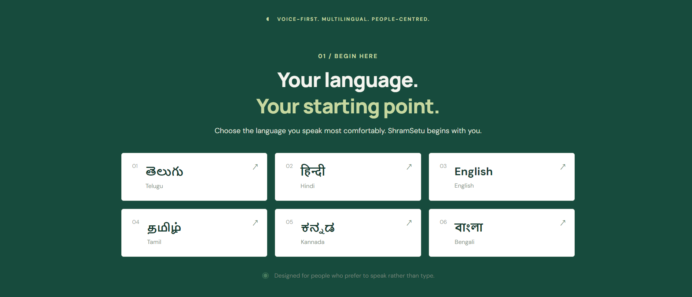
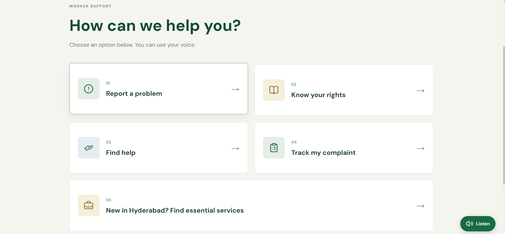
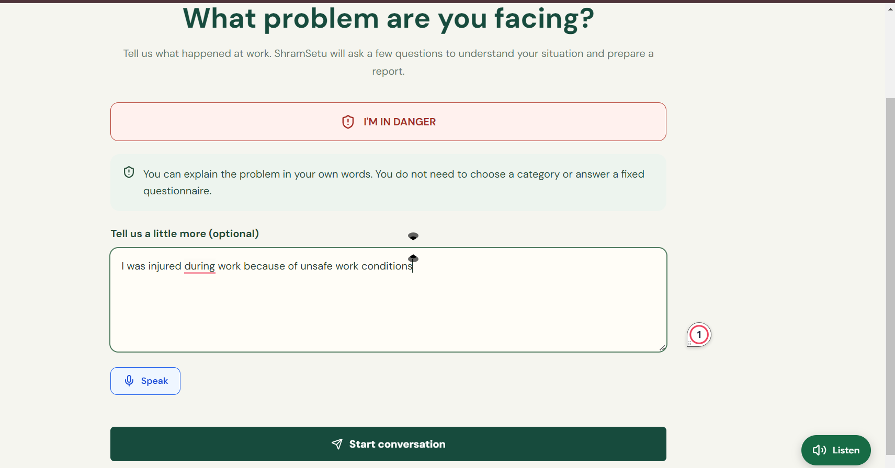
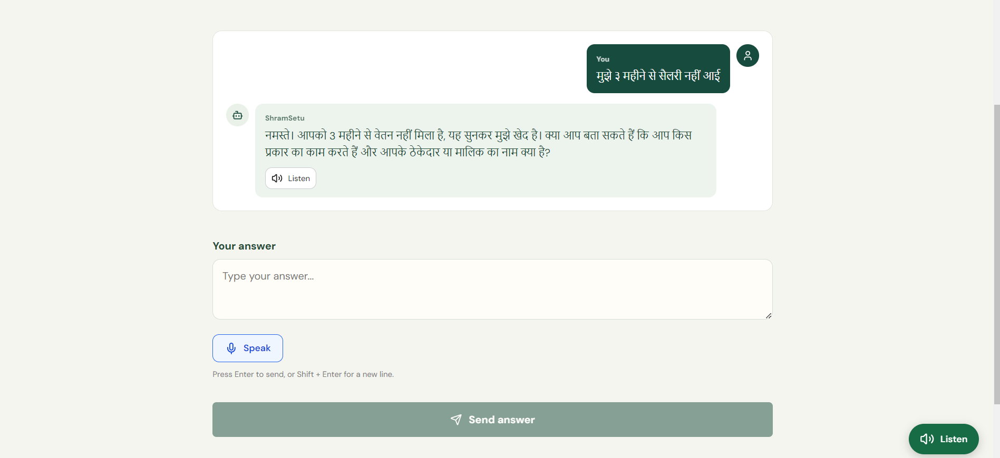
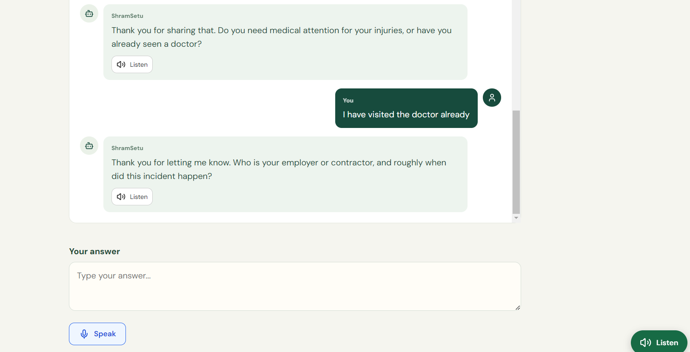
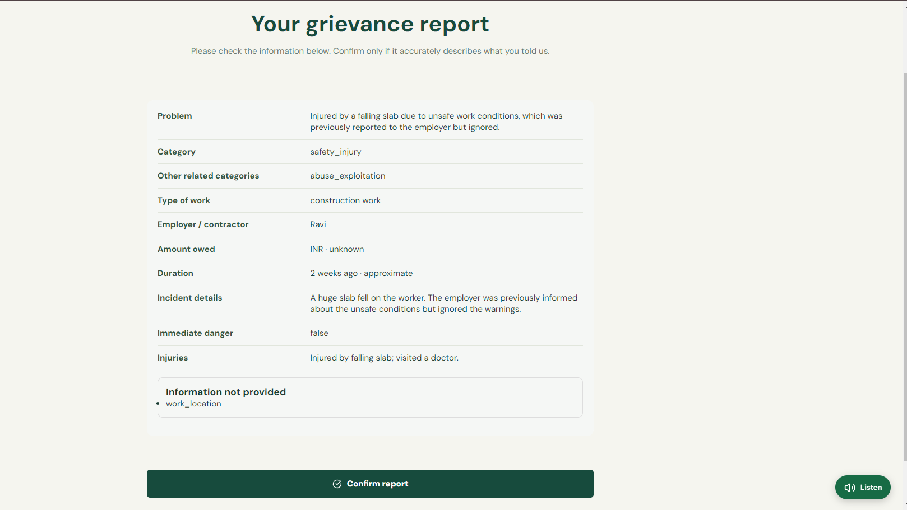
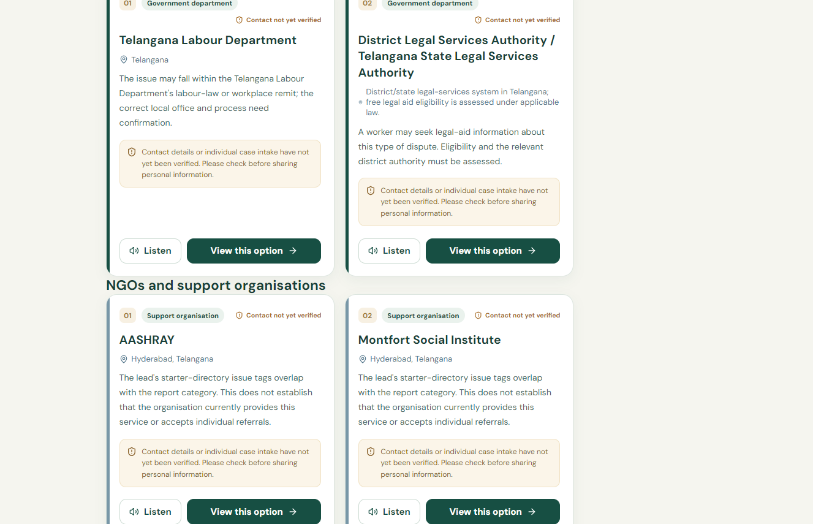
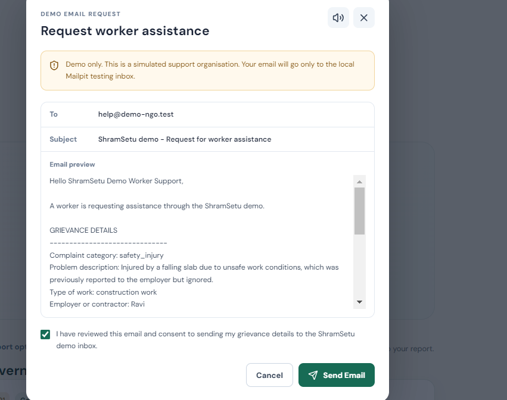
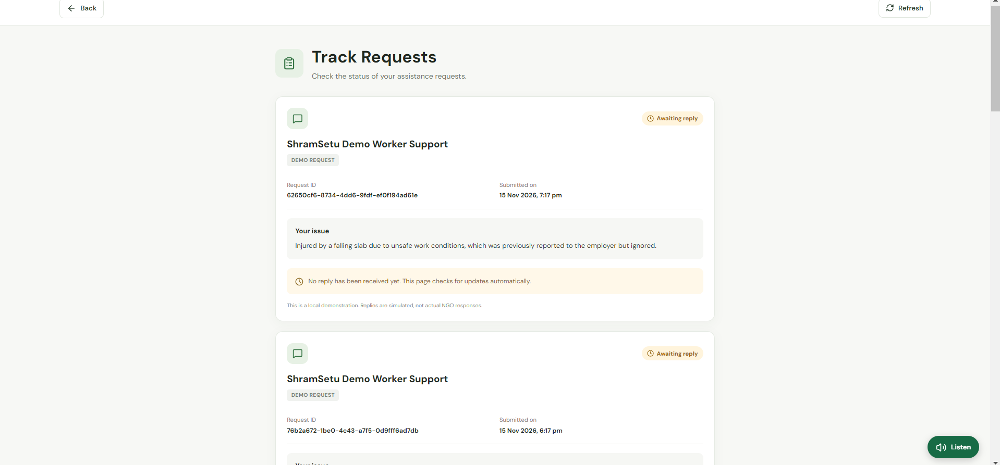
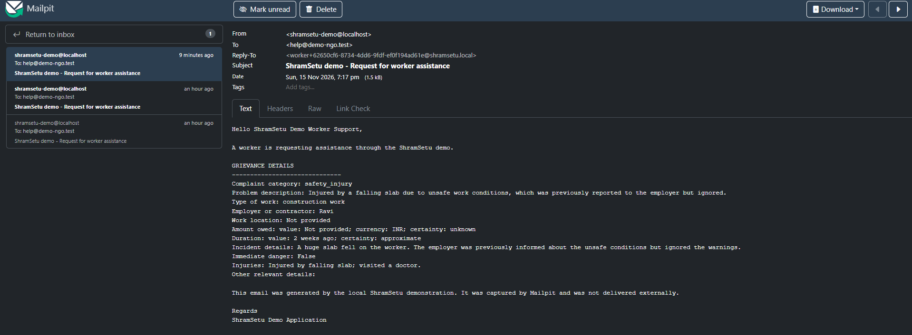

# ShramSetu
### Breaking Language Barriers. Connecting Workers to Their Rights.

ShramSetu is a multilingual worker-support platform designed to help migrant and informal workers understand their workplace rights, prepare complaints, navigate government grievance channels, and discover organisations that can provide support.

Built with a focus on accessibility, ShramSetu brings AI-assisted complaint preparation, speech technologies, multilingual guidance, and support discovery together in one platform.

---

## The Problem

Migrant and informal workers often face challenges when trying to raise workplace issues. Unpaid wages, unfamiliarity with labour rights, language barriers, and limited awareness of grievance mechanisms can make it difficult to seek help.

For a worker who has migrated to a new city, even identifying the right authority or organisation to approach can be a challenge.

**ShramSetu aims to make information and support more accessible, regardless of the language a worker speaks.**

---

## Application Walkthrough

### 1. Language Selection

ShramSetu supports six languages, allowing workers to interact with the platform in a language they are comfortable with.

**Supported languages:**
- English
- Telugu
- Hindi
- Tamil
- Kannada
- Bengali

### 2. Choosing How to Get Help

Workers can choose the type of assistance they need through a simple, accessible interface.

### 3. Reporting a Workplace Problem

Workers can start by selecting the option to report a problem and describing their workplace issue.

### 4. AI-Assisted Complaint Questionnaire

The platform uses an AI-assisted conversation to ask relevant follow-up questions and understand the worker's situation before preparing a structured complaint.

The questionnaire is available in the worker's selected language.

**Hindi interface**

**English interface**

### 5. Structured Complaint Report

Based on the information provided, ShramSetu prepares a structured complaint report that workers can review and use when approaching the relevant authorities or support organisations.

### 6. Finding Support Organisations

ShramSetu identifies relevant NGOs and support organisations based on the reported workplace issue, helping workers discover possible sources of assistance.

### 7. NGO Help Request

Workers can prepare an email describing their issue and requesting assistance from a relevant organisation.

### 8. Request Tracking

The platform includes a request-tracking interface to demonstrate how workers can follow the status of their help requests.

### 9. Email Workflow Demonstration

The prototype demonstrates the email workflow using a local email simulation environment. This illustrates how an email request can be generated and viewed as part of the tracking process.

---

## Key Features

- **Six-language interface:** English, Telugu, Hindi, Tamil, Kannada, and Bengali.
- **Voice accessibility:** Workers can describe their problems through speech.
- **AI-assisted conversations:** Follow-up questions help gather relevant details about workplace issues.
- **Complaint report generation:** Converts the collected information into a structured report.
- **Government grievance guidance:** Provides relevant complaint pathways and portal-specific instructions so workers can submit complaints through official government portals themselves.
- **NGO and support discovery:** Helps workers identify organisations relevant to their issues.
- **Email request preparation:** Helps prepare help requests addressed to support organisations.
- **Request tracking:** Demonstrates a workflow for following up on submitted help requests.
- **Information Hub:** Provides accessible information about workplace rights, support options, and guidance for workers new to Hyderabad.

---

## Technology Stack

| Technology | Purpose |
|---|---|
| React | Frontend application |
| JavaScript | Application logic and interactions |
| CSS | Interface styling |
| Python | Backend development |
| FastAPI | Backend API services |
| Gemini | AI-assisted conversations, follow-up questions, and complaint report generation |
| Gnani Prisma | Speech-to-text |
| Gnani Timbre | Text-to-speech |
| JSON | Structured complaint pathway data |
| SQLite | Local prototype data and request tracking |

### Gnani AI Speech Integration

ShramSetu integrates Gnani AI's speech technologies to make the platform more accessible to workers who may find typing difficult.

- **Gnani Prisma:** Converts spoken input into text.
- **Gnani Timbre:** Converts text-based information and guidance into speech.

These integrations allow workers to interact with the platform using both text and voice.

---

## How ShramSetu Works

1. The worker selects a preferred language.
2. The worker chooses the type of assistance required.
3. For workplace complaints, the worker describes the issue through text or voice.
4. The AI-assisted workflow asks relevant follow-up questions.
5. A structured complaint report is generated.
6. Relevant government complaint pathways and support organisations are identified.
7. The worker receives guidance on navigating official government portals or preparing a help request for an organisation.
8. The prototype demonstrates how help requests can be tracked.

---

## Current Implementation and Limitations

ShramSetu is a working prototype demonstrating a multilingual worker-support workflow.

- Government complaints are not automatically submitted by ShramSetu. Workers are guided through the relevant official portals and submit their complaints themselves.
- The NGO email workflow currently uses a local simulation environment. Actual email delivery to NGOs and real-time response tracking are planned for future development.
- The current implementation focuses on Telangana, with Hyderabad as the primary use case.

These limitations are important distinctions between the current demonstration and future production integrations.

---

## Future Scope

- Expand government complaint guidance to additional Indian states.
- Add more Indian languages.
- Integrate actual email delivery and response tracking.
- Explore partnerships with NGOs and worker-support organisations.
- Improve accessibility for low-bandwidth environments.
- Introduce secure document handling and additional worker-support workflows.

---

## Project Context

ShramSetu was developed as part of the **Great Indian AI Internship Challenge by Gnani AI**.

The project explores how multilingual AI, speech technologies, and accessible software workflows can help address real-world challenges faced by migrant and informal workers.

---

## Author

**Developed as an independent student project.**

**Project:** ShramSetu

**Focus:** Multilingual AI | Speech Technology | Labour Rights | Social Impact

---

*A worker's ability to seek help should never depend on the language they speak or how familiar they are with technology.*
